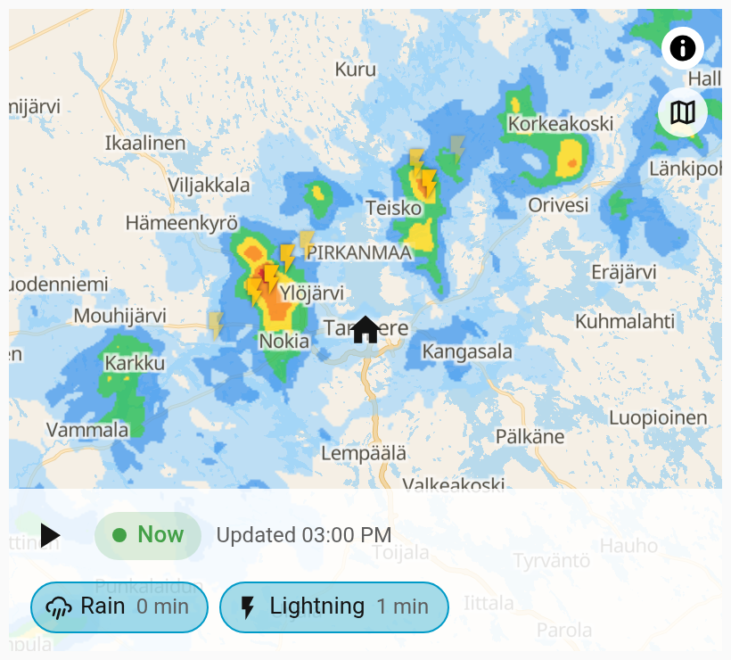
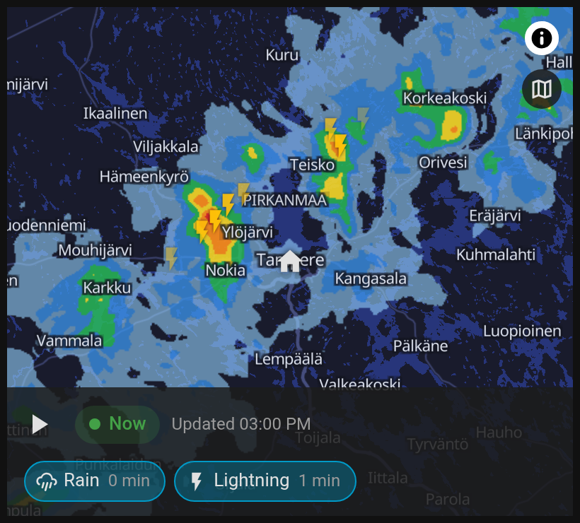
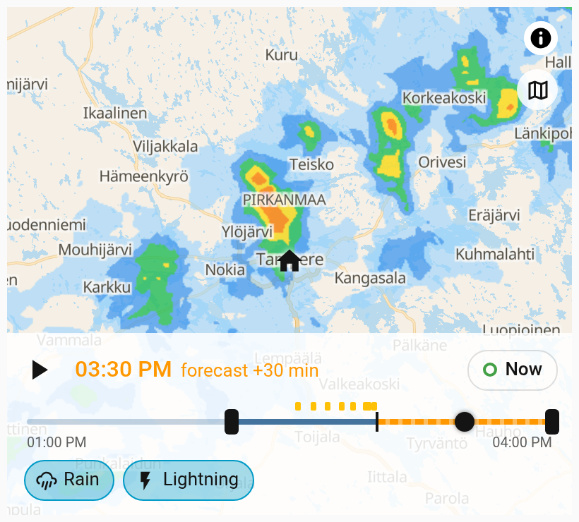
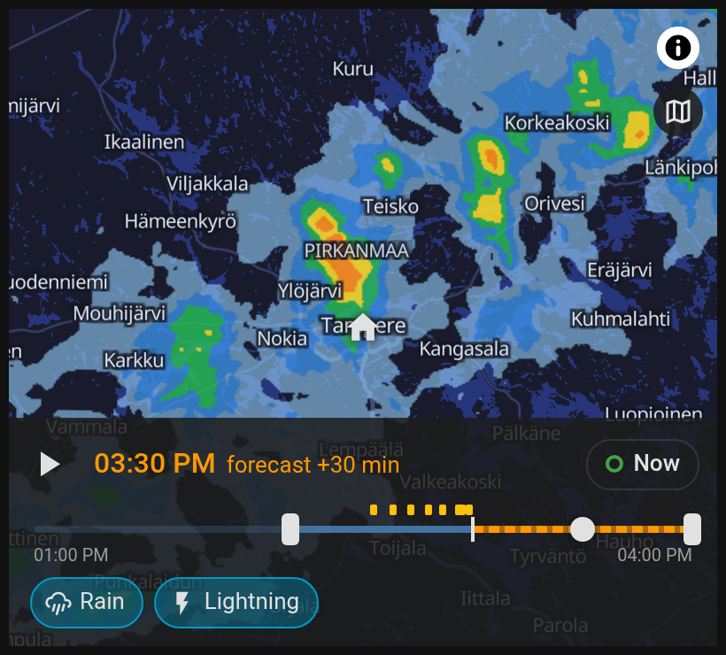

# Map timeline card

Home Assistant dashboard card that shows weather radar, its forecast, clouds, lightning and other map layers live, or
plays them on one timeline from the past into the forecast.

[![GitHub Release][releases-shield]][releases] [![GitHub Release Date][release-date-shield]][releases] [![Downloads][downloads-shield]][releases] [![Marketplace][marketplace-shield]][marketplace] [![License][license-shield]](LICENSE)

<p>




</p>

## What is it?

A custom card for map layers that change over time. Each layer comes from a source you set, in one of the standard
formats weather services and others publish their maps in. Those are WMS and WMTS with a time dimension, XYZ tiles
with the time in their address, a RainViewer-style API, GeoJSON, and Home Assistant's own geo_location entities, such
as Blitzortung's lightning strikes. The card doesn't know what a layer means, only how to draw it, so any source in those
formats works, from Finland's radar to satellite pictures of the Americas or the earthquakes of the past day.

By default the card shows the situation now, each layer at its newest frame. Press play and every layer that is on
plays on one timeline, the past and the forecast together, at the speed you set.

The map is Home Assistant's own, the same vector map its map card draws, with the same styles and the same light and
dark looks. It needs no map service or key of its own.

The card shows things over time. For things as they are now, such as the weather warnings in force or the trains on
the move, [Map feed card](https://github.com/jesmak/map-feed-card) is the one.

## Installation

### With the Marketplace

1. Open Settings › Marketplace, choose Add from link and paste `https://github.com/jesmak/map-timeline-card`
2. Open Map timeline card in the Marketplace and choose Install
3. Refresh your browser

### Manual

1. Take `dist/map-timeline-card.js` from the source code of the [latest release][releases] and copy it to the
   `config/www` folder of your Home Assistant installation
2. In Home Assistant settings, open dashboards, click the three dots at the top right and open resources
3. Add a new resource with the path `/local/map-timeline-card.js` and type JavaScript
4. Refresh your browser

The card needs Home Assistant 2026.9.3 or newer. Home Assistant serves the map tiles it draws since 2026.9.

## Options

Every option can be set in the card's visual editor, where each source is edited on its own with only the options of
its type. For a WMS or WMTS source, the editor reads the server's layers and styles and offers them as lists.

| Name          | Type   | Description                                                                                         | Default    |
| ------------- | ------ | --------------------------------------------------------------------------------------------------- | ---------- |
| `sources`     | list   | The map layers, each a source of its own (below). The first is drawn lowest.                        | `required` |
| `zone`        | string | A zone the map centres on, such as `zone.cabin`                                                     | home       |
| `zoom`        | number | The map's zoom near home, from 0 to 18                                                              | `8`        |
| `region_zoom` | number | The map's zoom for the whole region, which the card's map button switches to                        | `5`        |
| `map_style`   | string | `default`, `colorful`, `natural`, `muted`, `gray` or `toner`, as Home Assistant's map card has them | `default`  |
| `map_height`  | number | The map's height in pixels, at least 260                                                            | `440`      |
| `speed`       | number | How many minutes of the sources' time are played in a second                                        | `10`       |
| `row_step`    | string | On automatic rows in a sections view, whether the card's height rounds up to `full` or `half` rows  | `full`     |

### Sources

| Name              | Type           | Description                                                                                                                                                                                                                                                   | Default                       |
| ----------------- | -------------- | ------------------------------------------------------------------------------------------------------------------------------------------------------------------------------------------------------------------------------------------------------------- | ----------------------------- |
| `type`            | string         | `wms`, `wmts`, `xyz`, `rainviewer`, `geojson` or `geo_location`                                                                                                                                                                                               | `required`                    |
| `url`             | string         | The source's address, as its type describes below. Not for `geo_location`                                                                                                                                                                                     | `required`                    |
| `layer`           | string         | A WMS or WMTS layer's name, required for them. For `rainviewer`, `radar` or `satellite`                                                                                                                                                                       | `radar` for `rainviewer`      |
| `name`            | string         | The name on the source's chip below the map                                                                                                                                                                                                                   | its layer or its type         |
| `icon`            | string         | An icon for its chip, and for its points on the map. Points without one are dots                                                                                                                                                                              |                               |
| `style`           | string         | A WMS or WMTS style the server offers                                                                                                                                                                                                                         | the server's first or default |
| `color_scheme`    | number         | A RainViewer API's colour scheme, by its number                                                                                                                                                                                                               | the server's first            |
| `history_minutes` | number         | How far back the source goes                                                                                                                                                                                                                                  | `120`                         |
| `opacity`         | number         | How opaque its frames are, above 0 and up to 1                                                                                                                                                                                                                | `1`                           |
| `max_zoom`        | number         | The closest zoom the server has pictures for. Closer than this, the card enlarges them. A WMTS server says this itself                                                                                                                                        |                               |
| `step_minutes`    | number         | An XYZ source's step, a GeoJSON source's interval between reads, and a WMS or WMTS source's step when its server gives its times without one. For geo_location and a GeoJSON source with `time_property`, also the timeline's step when no image source is on | `5`                           |
| `delay_minutes`   | number         | How far behind now an XYZ source's newest picture is                                                                                                                                                                                                          | `0`                           |
| `stale_steps`     | number         | How many of its steps a source may go without a new frame before its chip warns                                                                                                                                                                               | `3`                           |
| `legend`          | string or bool | A legend image of your own, or `false` for none. A WMS or WMTS source shows its server's legend unless set                                                                                                                                                    |                               |
| `attribution`     | string         | Credits of your own, shown behind the map's info button. A WMS or WMTS source shows what its server gives unless set                                                                                                                                          |                               |
| `time_property`   | string         | The property a GeoJSON feature's time is in. Without one, every feature is shown at every moment                                                                                                                                                              |                               |
| `source`          | string         | The `source` attribute of the geo_location entities to show, such as `blitzortung`                                                                                                                                                                            | every geo_location entity     |
| `time_attribute`  | string         | The attribute a geo_location entity's time is in                                                                                                                                                                                                              | `publication_date`            |
| `visible_minutes` | number         | How long a GeoJSON feature or a geo_location entity stays on the map after its time                                                                                                                                                                           | `30`                          |
| `timeline_marks`  | bool           | A mark above the timeline for each GeoJSON feature or geo_location entity with a time                                                                                                                                                                         | `false`                       |
| `color`           | string         | A hex colour, such as `#ffc107`, for the points, lines and areas that name none of their own                                                                                                                                                                  | the theme's primary colour    |

## What it shows

**Live**, the card's default, each source shows its newest frame, and the chips at the bottom of the map say how old
each one is.
A chip warns when its source's newest frame hasn't changed for `stale_steps` of its steps while the card was open, and
says when a source can't be read and why. Tap a chip to switch its layer off and on. The buttons on the map open the
legends of the layers that are on, when they have one, switch between home and the whole region, and open the credits.

**Playing**, every source that is on plays on one timeline at the shortest step among them, never under a minute. The
handles on the timeline set the window that is played, from the last hour through all the forecast unless moved, and
the timeline can be scrubbed by hand. The part of the timeline ahead of now is the forecast, striped, and while the
time played is in it, the time turns the forecast's colour and says how far ahead it is. In the forecast only the sources
with frames ahead are shown, so an observation is never shown under another source's forecast as if both were of the
same moment. Playing never returns to live by itself. The Now button does.

**Points**, such as lightning strikes or earthquakes, fade from full to a quarter over `visible_minutes` after their
time, and then go. One without a time shows only live. With `timeline_marks`, each has a mark above the timeline, so a
storm's strikes show where they were in time. Lines and areas from GeoJSON don't fade, as an area half faded would
look half over, and are drawn in their own simplestyle colours (`fill`, `fill-opacity`, `stroke`, `stroke-width`,
`stroke-opacity`) or in the source's colour.

**The layers** are drawn in the order of `sources`, the first lowest, the lines and areas over the pictures and the
points over everything. The base map's borders and place names stay on top of the layers, so the view can be told even
under clouds or rain.

**The card's size**: it takes a sections view's whole width unless set otherwise. On automatic rows it is as tall as
`map_height`, rounded up to whole or half rows so the cards under it stay on the rows. Given rows in the layout tab,
the map fills them, and the card is never lower than 260 pixels, which keeps the playing bar, the chips and some map in
view.

## Formats and sources

Each format with sources that answered when the card was built, as examples. Their terms and licences are their own,
so check them before you use a source. The card reads every source from the browser, so a server has to allow other
origins, as all of these do. A dashboard opened over https can't read a server over plain http, as the browser blocks
it.

### WMS

`url` is the service's address. The card reads the layer's times, styles and legends from its capabilities.

- **Finnish Meteorological Institute** (`https://openwms.fmi.fi/geoserver/wms`): Finland's radar,
  `Radar:suomi_dbz_eureffin`, a week back in 5 minute steps.
- **EUMETSAT** (`https://view.eumetsat.int/geoserver/wms`): clouds seen by Meteosat, `mtg_fd:rgb_geocolour` by
  day and night and the infrared `mtg_fd:ir105_hrfi`, in 10 minute steps. EUMETSAT asks for the attribution "Contains
  modified EUMETSAT Meteosat data" with the year.
- **Deutscher Wetterdienst** (`https://maps.dwd.de/geoserver/dwd/wms`): Germany's radar `Niederschlagsradar`, the
  radar with about two hours of forecast in `Radar_wn-product_1x1km_ger`, and lightning density `Blitzdichte`, in 5
  minute steps.
- **Environment Canada** (`https://geo.weather.gc.ca/geomet`): Canada's radar `RADAR_1KM_RRAI`, three hours back in 6
  minute steps.

### WMTS

`url` is the address of the server's capabilities document. The card takes the layer's tile address that has the time
in it, and a tile matrix set in Web Mercator.

- **NASA GIBS** (`https://gibs.earthdata.nasa.gov/wmts/epsg3857/best/1.0.0/WMTSCapabilities.xml`): among many others,
  the geostationary infrared over the Americas, `GOES-East_ABI_Band13_Clean_Infrared`, and over Asia and Australia,
  `Himawari_AHI_Band13_Clean_Infrared`, in 10 minute steps. Their newest frames are 40 to 50 minutes behind now, and
  the capabilities, 6 MB of them, may be cached for half an hour on the way, so `stale_steps: 9` keeps the chip from
  warning about a delay that is normal.

### XYZ with the time in the address

`url` is a tile address with `{z}`, `{x}` and `{y}`, which the map fills in, and the frame's time as `{time:…}` in a
pattern of `YYYY`, `MM`, `DD`, `HH`, `mm` and `ss`, in UTC. Nothing lists which times exist, so the frames are whole
`step_minutes` of the clock, from `history_minutes` back up to `delay_minutes` behind now.

- **Iowa Environmental Mesonet**: the radar composite of the United States,
  `https://mesonet.agron.iastate.edu/cache/tile.py/1.0.0/ridge::USCOMP-N0Q-{time:YYYYMMDDHHmm}/{z}/{x}/{y}.png`, in 5
  minute steps.

### RainViewer API

`url` is the server's address. The card reads its `/public/weather-maps.json`, with the radar's past and forecast
frames and the satellite's.

- **LibreWXR** (`https://api.librewxr.net`): radar with an hour of forecast, and infrared satellite. The
  public server is a best-effort service under CC BY 4.0, and LibreWXR can be run on
  [a server of your own](#a-radar-server-of-your-own).
- **RainViewer** (`https://api.rainviewer.com`): past radar frames, without a forecast. Closer than zoom 7 it answers
  with a picture saying so instead of the radar, so set `max_zoom: 7`.

### GeoJSON

`url` is the address of a feature collection, read again every `step_minutes`. Points are drawn as the source's icon or
as dots, lines and areas as shapes. With `time_property`, each feature is shown at its time, which may be in seconds or
milliseconds since 1970, or an ISO 8601 time.

- **USGS** (`https://earthquake.usgs.gov/earthquakes/feed/v1.0/summary/all_day.geojson`): the past day's earthquakes,
  their times in `time`.

### geo_location entities

The geo_location entities Home Assistant has, picked by their `source` attribute, each at the time in its
`publication_date`.

- **Blitzortung**: lightning strikes, with `source: blitzortung`. The integration keeps each strike for its time window.

### Other data

Data in any other format can be brought in as GeoJSON. A small script that writes a feature collection into Home
Assistant's `config/www` folder is enough, and the card reads it from `/local` without a host, so the same address
works at home and away. Home Assistant tells browsers to keep files in that folder for a month, so the card asks for
the file again every time, and Home Assistant's service worker shows the change one read late.

Here is such a script in Python, using only its standard library. It reads points from a JSON list somewhere, each with
a latitude, a longitude and a time, and writes them as GeoJSON. Run it as often as the data changes, from cron or
anything else that runs on a schedule.

```python
import json
import os
import urllib.request

SOURCE = "https://example.com/observations.json"  # a list of { "lat", "lon", "time" }
TARGET = "/config/www/observations.geojson"

with urllib.request.urlopen(SOURCE) as response:
    observations = json.load(response)

features = [
    {
        "type": "Feature",
        "geometry": {"type": "Point", "coordinates": [item["lon"], item["lat"]]},
        "properties": {"time": item["time"]},
    }
    for item in observations
]
with open(TARGET + ".tmp", "w") as file:
    json.dump({"type": "FeatureCollection", "features": features}, file)
# Replaced in one go, so the card never reads a file half written.
os.replace(TARGET + ".tmp", TARGET)
```

```yaml
- type: geojson
  name: Observations
  url: /local/observations.geojson
  time_property: time
  visible_minutes: 60
```

## A radar server of your own

The public LibreWXR server is a best-effort service, and it blends the radar into weather models, so an hour ahead its
forecast can be more model than radar. [LibreWXR](https://github.com/JoshuaKimsey/LibreWXR) can be run on a server of
your own with Docker, and the card reads it like any other RainViewer API. These settings give one region's radar with
an hour of forecast extrapolated from the radar alone, and nothing else.

Clone LibreWXR's repository at its newest release, copy its `.env.example` to `.env` and change these in it:

```ini
LIBREWXR_IMAGE_TAG=1.0.0
LIBREWXR_PORT=8097
LIBREWXR_PUBLIC_URL=https://radar.example.com
LIBREWXR_WORKERS=1
LIBREWXR_ENABLED_REGIONS=OPERA
LIBREWXR_NOWCAST_BLEND_MODE=radar
LIBREWXR_ECMWF_ENABLED=false
LIBREWXR_REGIONAL_NWP_ENABLED=false
LIBREWXR_RRQPE_ENABLED=false
LIBREWXR_SATELLITE_ENABLED=false
LIBREWXR_ALERTS_ENABLED=false
LIBREWXR_LIGHTNING_ENABLED=false
LIBREWXR_STORM_CELLS_ENABLED=false
LIBREWXR_MCP_ENABLED=false
LIBREWXR_WEBSOCKET_ENABLED=false
```

- **`LIBREWXR_ENABLED_REGIONS`** is the radar composite to read. `OPERA` is EUMETNET's composite of Europe's radars,
  and `.env.example` lists the others.
- **`LIBREWXR_PUBLIC_URL`** is the address the card reaches the server at, as the server gives it in its catalogue.
- **`LIBREWXR_NOWCAST_BLEND_MODE=radar`** makes the forecast from the radar alone, so the weather models can stay off.
  With ECMWF's model on, the pipeline crashed with `Illegal instruction` on a CPU without AVX2.

Start it with `docker compose up -d` in the repository's folder. It has its frames in about a minute, and
`/public/weather-maps.json` lists 12 observed frames ten minutes apart and 6 forecast ones. The first forecast
after a start only repeats the newest frame. With these settings the two containers took 1.3 to 1.7 GB of memory
between them.

LibreWXR writes its caches to disk, and with all of them there it wrote 14 GB in six hours. A
`docker-compose.override.yml` beside its compose file can keep them in memory, which took about 320 MB:

```yaml
services:
  pipeline:
    volumes:
      - /dev/shm/librewxr:/dev/shm/librewxr
      - /dev/shm/librewxr-cache:/data/cache
  renderer:
    volumes:
      - /dev/shm/librewxr:/dev/shm/librewxr
      - /dev/shm/librewxr-cache:/data/cache
```

with `LIBREWXR_VOLATILE_CACHE_DIR=/dev/shm/librewxr` in `.env`.

A dashboard opened over https reads the server only over https, so put it behind a reverse proxy with a certificate,
which also lets the card read it away from home. The server allows any origin by default. Then the source is:

```yaml
- type: rainviewer
  name: Forecast
  icon: mdi:weather-cloudy-clock
  url: https://radar.example.com
  color_scheme: 8
  attribution: Rain © EUMETNET OPERA
```

Without `color_scheme`, the card takes the first scheme the server lists, which on LibreWXR is black and white.
OPERA's composites are under CC BY 4.0, so credit EUMETNET.

## Examples

Finland's radar with an hour of forecast and Blitzortung's lightning, which is what the gallery shows with made-up data:

```yaml
type: custom:map-timeline-card
sources:
  - type: wms
    name: Radar
    icon: mdi:weather-pouring
    url: https://openwms.fmi.fi/geoserver/wms
    layer: Radar:suomi_dbz_eureffin
  - type: rainviewer
    name: Forecast
    icon: mdi:weather-cloudy-clock
    url: https://api.librewxr.net
  - type: geo_location
    name: Lightning
    icon: mdi:flash
    source: blitzortung
    timeline_marks: true
    color: "#ffc107"
```

Clouds under the radar, the clouds drawn lowest as they come first:

```yaml
type: custom:map-timeline-card
zoom: 6
sources:
  - type: wms
    name: Clouds
    icon: mdi:weather-cloudy
    url: https://view.eumetsat.int/geoserver/wms
    layer: mtg_fd:ir105_hrfi
    opacity: 0.6
    attribution: Contains modified EUMETSAT Meteosat data
  - type: wms
    name: Radar
    icon: mdi:weather-pouring
    url: https://openwms.fmi.fi/geoserver/wms
    layer: Radar:suomi_dbz_eureffin
```

The radar of the United States over the infrared from space, with the past day's earthquakes:

```yaml
type: custom:map-timeline-card
region_zoom: 3
sources:
  - type: wmts
    name: Infrared
    url: https://gibs.earthdata.nasa.gov/wmts/epsg3857/best/1.0.0/WMTSCapabilities.xml
    layer: GOES-East_ABI_Band13_Clean_Infrared
    opacity: 0.6
    stale_steps: 9
  - type: xyz
    name: Radar
    url: https://mesonet.agron.iastate.edu/cache/tile.py/1.0.0/ridge::USCOMP-N0Q-{time:YYYYMMDDHHmm}/{z}/{x}/{y}.png
  - type: geojson
    name: Earthquakes
    icon: mdi:pulse
    url: https://earthquake.usgs.gov/earthquakes/feed/v1.0/summary/all_day.geojson
    time_property: time
    visible_minutes: 1440
    history_minutes: 1440
```

## Data

The layers come from the sources the card is given, each under its own terms. The card itself fetches only the base
map from Home Assistant, which fetches it from [VersaTiles](https://versatiles.org/) and
[OpenStreetMap](https://www.openstreetmap.org/copyright). The geo_location entities come from Home Assistant's own
state.

## Translating

The card's texts are in `src/localize/languages/`, one JSON file per language, named by its language code, such as
`en.json` and `fi.json`. To add a language, copy `en.json` to the new language's code, such as `sv.json`, and translate
the values. A file may name a region, such as `pt-br.json`. It is used for `pt-BR`, falling back to a file for the
language alone (`pt.json`), and then to English. Nothing else needs changing. The card finds the file by itself and uses
it when Home Assistant is set to that language. A text left out falls back to English.

## Development

Requires Node 22.13 or newer.

```
npm install
npm run check
```

`npm run check` typechecks, lints, checks formatting, runs the tests and builds `dist/map-timeline-card.js`, which is
the file the Marketplace installs and is committed to the repository. MapLibre is bundled with the card, its worker
included, so the card stays one file.

The README's screenshots are made from made-up data. `scripts/screenshot-rain.mjs` draws the rain into `docs/rain` as
a RainViewer-style server, and `docs/screenshots.json` is the plan the screenshots are taken from.

| Path                          | What it contains                                            |
| ----------------------------- | ----------------------------------------------------------- |
| `src/map-timeline-card.ts`    | The card itself, its bars, chips and timeline               |
| `src/editor.ts`               | The visual editor                                           |
| `src/options.ts`              | The card's options, checked when they are set               |
| `src/sources.ts`              | Reading a source of any type                                |
| `src/wms.ts`                  | WMS capabilities and tiles                                  |
| `src/wmts.ts`                 | WMTS capabilities and tiles                                 |
| `src/xyz.ts`                  | XYZ tiles with the time in their address                    |
| `src/rainviewer.ts`           | A RainViewer API's catalogue                                |
| `src/geojson.ts`              | GeoJSON features                                            |
| `src/geolocation.ts`          | Home Assistant's geo_location entities, and how points fade |
| `src/time.ts`                 | Times, frames and the timeline                              |
| `src/map.ts`                  | The map, its frames, points, lines and areas                |
| `src/map-tiles.ts`            | Home Assistant's map tiles and styles                       |
| `src/map-theme.ts`            | Home Assistant's map colours and themes                     |
| `src/height.ts`               | The card's grid rows                                        |
| `src/rows.ts`                 | Rounding the height on automatic rows to whole or half      |
| `src/hass.ts`                 | The parts of Home Assistant's objects the card uses         |
| `src/localize/languages/`     | The card's texts, one JSON file per language                |
| `scripts/screenshot-rain.mjs` | The made-up rain of the screenshots                         |
| `tests/`                      | Tests, run with vitest                                      |

## Contributing

Pull requests are welcome. Open them against the `dev` branch, where the work for the next release is collected.
`main` holds the latest release and moves only when a new one is made, so this README always describes the released
version.

## Support

Hey dude! Help me out for a couple of :beers: or a :coffee:!

[](https://www.buymeacoffee.com/jesmak)

## Thanks

The map is drawn with [MapLibre GL JS](https://maplibre.org/) (BSD 3-Clause, see
[LICENSE-maplibre-gl](LICENSE-maplibre-gl)), and its styles are built with
[VersaTiles style](https://github.com/versatiles-org/versatiles-style) (MIT, see
[LICENSE-versatiles-style](LICENSE-versatiles-style)), both bundled with the card. Home Assistant's map colours and
the table of its themes' map colours come from the [Home Assistant frontend](https://github.com/home-assistant/frontend)
(Apache 2.0, see [LICENSE-home-assistant-frontend](LICENSE-home-assistant-frontend)), so the card's map looks like
Home Assistant's own.

## License

MIT, see [LICENSE](LICENSE).

[releases-shield]: https://img.shields.io/github/release/jesmak/map-timeline-card.svg?style=for-the-badge
[release-date-shield]: https://img.shields.io/github/release-date/jesmak/map-timeline-card?style=for-the-badge
[releases]: https://github.com/jesmak/map-timeline-card/releases
[downloads-shield]: https://img.shields.io/github/downloads/jesmak/map-timeline-card/total.svg?style=for-the-badge
[marketplace-shield]: https://img.shields.io/badge/Marketplace-Custom-orange.svg?style=for-the-badge
[marketplace]: https://my.home-assistant.io/redirect/marketplace_repository/?owner=jesmak&repository=map-timeline-card&category=plugin
[license-shield]: https://img.shields.io/github/license/jesmak/map-timeline-card.svg?style=for-the-badge
